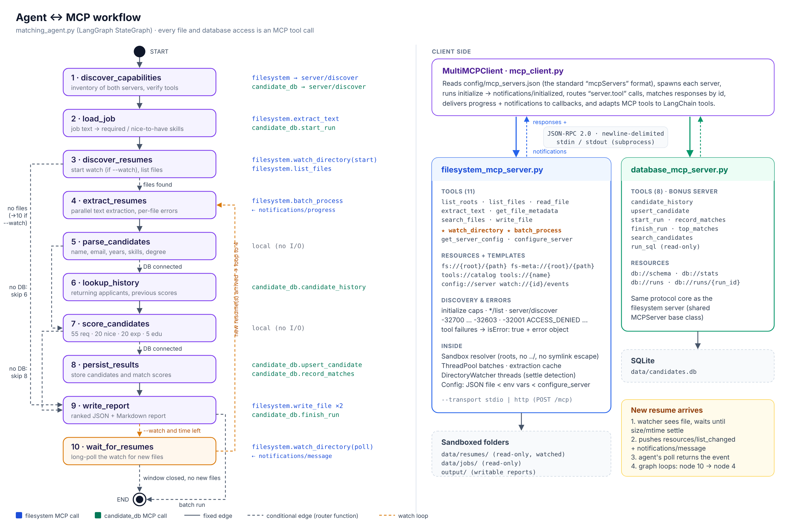

# Milestone 2 – Resume Matcher on the Model Context Protocol

The Milestone 1 file-system tools now live in a standalone **MCP server**, and the LangGraph
**matching agent** reaches every file (and a candidate database) only through MCP clients.

```
matching_agent.py ──► mcp_client.py ──JSON-RPC 2.0 / stdio──► filesystem_mcp_server.py ──► data/, output/
   (LangGraph)       (MultiMCPClient)  ──JSON-RPC 2.0 / stdio──► database_mcp_server.py   ──► SQLite
```



## Deliverables

| Requirement | Where |
|---|---|
| MCP filesystem server | `filesystem_mcp_server.py` |
| Milestone 1 tools exposed over MCP | tools `list_roots`, `list_files`, `read_file`, `extract_text`, `get_file_metadata`, `search_files`, `write_file`; also browsable as resources `tools://catalog`, `tools://{name}` and files as `fs://{root}/{path}` |
| `watch_directory()` | tool with `start / poll / stop / list`, settle detection, auto text preview, push notifications |
| `batch_process()` | tool: `extract_text / metadata / read / hash` over paths or a directory, thread pool, per-file errors, `continue_on_error`, progress notifications |
| JSON-RPC 2.0 compliance | single + batch messages, notifications, id echoing, standard error codes — `tests/test_jsonrpc_protocol.py` |
| Error handling and status codes | `ErrorCode` table, `isError` tool results, HTTP 200/202/400/404/405/413/415 — see `docs/architecture.md#error-model` |
| Resource discovery | `resources/list` (paginated), `resources/templates/list`, `resources/read`, subscribe/unsubscribe, `server/discover`, `GET /.well-known/mcp.json` |
| Configuration management | `config/filesystem_server.json` < env vars (`MCP_FS_<ROOT>_DIR`, `MCP_FS_LOG_LEVEL`) < runtime `configure_server` tool; `config://server` resource |
| Refactored LangGraph agent | `matching_agent.py` — no direct file access (enforced by a test) |
| MCP client | `mcp_client.py` (stdio + HTTP, multi-server, LangChain tool adapter) |
| Multi-MCP bonus | `database_mcp_server.py` + `config/mcp_servers.json` (an optional third-party `mcp-server-fetch` entry is included, disabled) |
| State machine / workflow diagram | `docs/workflow_diagram.svg/.png`, `docs/agent_graph.mmd`, sequence diagrams in `docs/architecture.md` |
| Test scenarios | `tests/` (60 tests) and `docs/TEST_SCENARIOS.md` |
| Demo video | script and shot list in `docs/DEMO_SCRIPT.md` |

## Setup

```bash
python -m venv .venv && source .venv/bin/activate      # Windows: .venv\Scripts\activate
pip install -r requirements.txt
python scripts/generate_sample_data.py                  # sample JD + 6 resumes (PDF/DOCX/TXT/MD) + 1 corrupt PDF
```

Python 3.10+ is required (tested on 3.13 and Windows 11). On Windows the symlink sandbox test is skipped unless Developer Mode is on.

## Run

```bash
# Batch run: both MCP servers, ranked report in output/
python matching_agent.py

# Run again: candidate_db now recognises returning applicants
python matching_agent.py

# Watch mode: keeps screening for 60 s; copy a resume in from another terminal
python matching_agent.py --watch --watch-seconds 60
cp data/incoming_samples/kavya_nair.txt data/resumes/    # PowerShell: Copy-Item data\incoming_samples\kavya_nair.txt data\resumes\

# Filesystem server only
python matching_agent.py --no-db

# Tests
python -m pytest -q
```

### Talking to the server directly

```bash
# stdio (what MCP hosts do)
printf '%s\n' \
 '{"jsonrpc":"2.0","id":1,"method":"initialize","params":{"protocolVersion":"2025-06-18","capabilities":{},"clientInfo":{"name":"cli","version":"1"}}}' \
 '{"jsonrpc":"2.0","method":"notifications/initialized"}' \
 '{"jsonrpc":"2.0","id":2,"method":"tools/call","params":{"name":"list_files","arguments":{"directory":"resumes"}}}' \
 | python filesystem_mcp_server.py --config config/filesystem_server.json

# HTTP (handy for curl and health checks)
python filesystem_mcp_server.py --config config/filesystem_server.json --transport http --port 8765
python scripts/http_demo.py        # or: bash scripts/http_demo.sh
```

### Using the server from other MCP hosts

The server speaks standard MCP over stdio, so it works with any MCP host. For Claude Desktop, add to
`claude_desktop_config.json`:

```json
{"mcpServers": {"resume-files": {"command": "python",
  "args": ["/abs/path/filesystem_mcp_server.py", "--config", "/abs/path/config/filesystem_server.json"]}}}
```

Interoperability with the official MCP Python SDK client is checked in
`tests/test_transports_and_interop.py::test_official_mcp_sdk_client_interop` (skipped if `mcp` isn't installed).

## Design notes

- **Protocol core written directly on JSON-RPC 2.0** (`MCPServer` class) rather than hidden behind an SDK,
  so the compliance work is visible and testable. Both servers share it.
- **Sandbox**: every path is `root/relative`; roots are fixed at start-up and can't be changed by clients.
- **Tool errors vs protocol errors**: protocol problems are JSON-RPC errors; tool failures are results with
  `isError: true`, so the agent keeps going (the corrupt PDF ends up in the report's error list).
- **Concurrency**: stdio requests run on a worker pool, so a long `watch_directory` poll doesn't block pings,
  other calls, or `notifications/cancelled`.
- **Watching** uses portable polling with settle detection (a file is reported once its size/mtime stop
  changing), avoiding half-copied uploads.
- **Scoring is deterministic** (55 required skills · 20 nice-to-have · 20 experience · 5 education;
  shortlist ≥ 75, review ≥ 55, and < 50% required coverage is always a reject). `MultiMCPClient.to_langchain_tools()`
  and the server's `screen_resume` prompt are ready if you want an LLM to drive or explain the scoring.

## Layout

```
filesystem_mcp_server.py   MCP server (Part A)
matching_agent.py          LangGraph agent (Part B)
mcp_client.py              MCP clients (stdio, HTTP, multi-server)
database_mcp_server.py     second MCP server (bonus)
config/                    server + client configuration
data/                      jobs, resumes, incoming_samples, candidates.db (created)
output/                    reports written via MCP
docs/                      diagrams, architecture, test scenarios, demo script
scripts/                   sample-data generator, HTTP demo
tests/                     pytest scenarios
```
