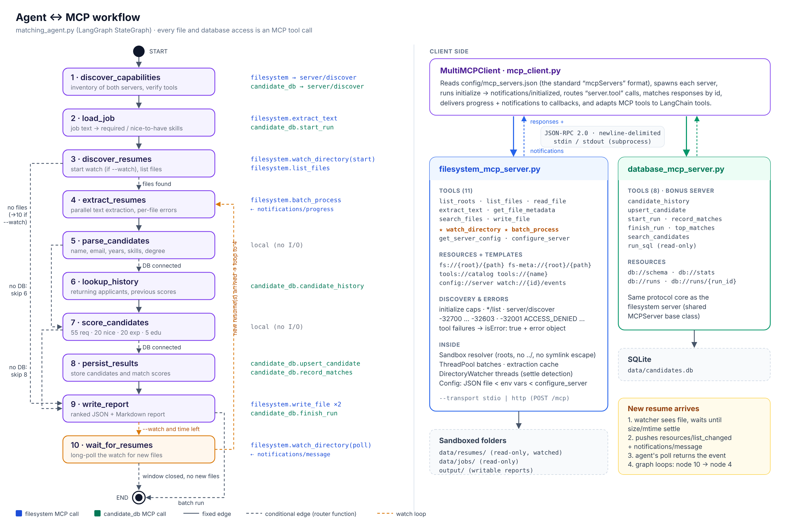
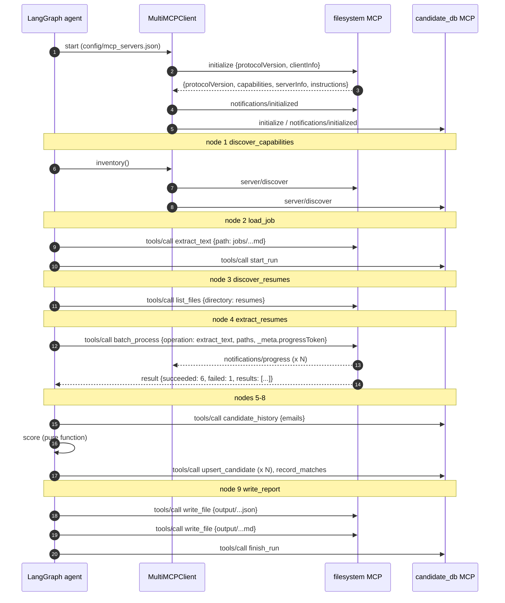

# Architecture and agent ↔ MCP interaction



`workflow_diagram.svg` / `.png` show the LangGraph state machine on the left (with the MCP call each node
makes) and the client/server architecture on the right. `agent_graph.mmd` is the graph exported directly
from LangGraph (`python matching_agent.py --mermaid`), so it always matches the code.

## Before vs after (Milestone 1 → Milestone 2)

| | Milestone 1 | Milestone 2 (this project) |
|---|---|---|
| File access | Python functions imported into the agent | `filesystem_mcp_server.py`, separate process |
| Interface | Function signatures | MCP tools with JSON Schema, discovered at runtime |
| Errors | Python exceptions | JSON-RPC error codes + `isError` tool results |
| Security | Agent can open any path | Server-side sandbox: named roots, read-only inputs, no `..`/symlink escape |
| New files | Re-run the agent | `watch_directory` + push notifications, agent loops |
| Many files | Loop in the agent | `batch_process` with a thread pool and progress notifications |
| Other data | — | Second MCP server (candidate database) through the same client |
| Reuse | Agent-specific | Any MCP host (Claude Desktop, the official SDK, other agents) can use the servers |

## Sequence: one batch run



## Sequence: watch mode (a new resume arrives)

```mermaid
sequenceDiagram
    participant G as LangGraph agent
    participant FS as filesystem MCP
    participant W as DirectoryWatcher thread
    participant U as Recruiter / ATS

    G->>FS: watch_directory {action: start, directory: resumes}
    FS->>W: start polling (interval 1s)
    FS-->>G: {watch_id: w_..., tracked_files: 7}
    G->>FS: watch_directory {action: poll, timeout_s: 10}
    U->>W: copies kavya_nair.txt into data/resumes
    W->>W: scan 1: new file, pending; scan 2: size/mtime unchanged → settled
    W-->>G: notifications/message {event: file_created, path}
    W-->>G: notifications/resources/list_changed
    FS-->>G: poll result {events: [{type: created, path: resumes/kavya_nair.txt}]}
    G->>FS: batch_process {paths: [resumes/kavya_nair.txt]}
    Note over G: parse → history → score → persist → write_report (updated ranking)
    G->>FS: watch_directory {action: poll} … until the window closes
    G->>FS: watch_directory {action: stop}
```

## Error model

| Situation | How it is reported | Code |
|---|---|---|
| Malformed JSON | JSON-RPC error, `id: null` (HTTP 400) | -32700 |
| Not a valid request object / wrong `jsonrpc` / bad id | JSON-RPC error (HTTP 400) | -32600 |
| Unknown method | JSON-RPC error, lists available methods | -32601 |
| Unknown tool, arguments fail the tool's JSON Schema | JSON-RPC error with `data.problems` | -32602 |
| Request before `initialize` (stdio) | JSON-RPC error | -32010 |
| Unexpected exception | JSON-RPC error with type, no traceback leak | -32603 |
| Resource URI not found | JSON-RPC error (MCP convention) | -32002 |
| Tool failed (missing file, sandbox escape, read-only root, too large, corrupt PDF, ...) | `result.isError: true` with `{error: {code, type, message, details}}` and a `notifications/message` warning | -32001 … -32011 |
| One file in a batch fails | Batch succeeds; that entry has `status: error` | per file |

Tool failures are deliberately *results*, not protocol errors (as the MCP spec recommends), so the
agent (or an LLM) can read the reason and carry on — e.g. the corrupt upload is listed in the report
instead of crashing the run.
